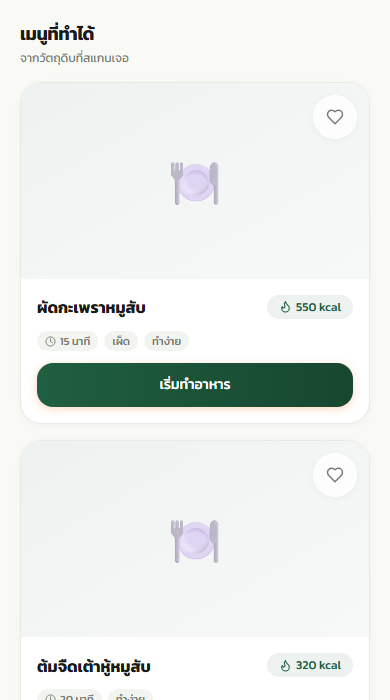
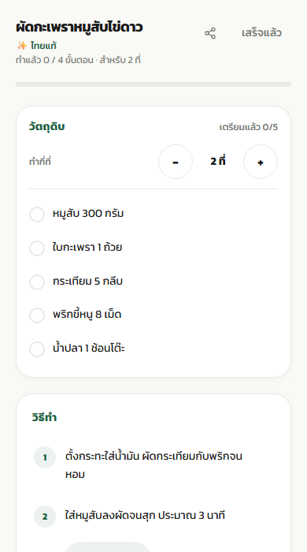

<div align="center">

# 🍳 Chef Kub

*📸 ถ่ายรูปวัตถุดิบ → 🤖 AI แนะนำเมนูไทย → 👨‍🍳 ลงมือทำทีละขั้น*

</div>

โปรเจกต์จบที่ใช้ **Computer Vision + Generative AI** สแกนวัตถุดิบจากรูป คิดสูตรอาหารจากของที่มี แล้วพาทำทีละขั้นตอน
label ที่ผู้ใช้แก้ไว้ถูกเก็บเป็น dataset เพื่อ train โมเดลรอบต่อไป

<div align="center">
<table>
<tr>
<td width="50%" align="center"><br /><b>เมนูที่ทำได้</b></td>
<td width="50%" align="center"><br /><b>โหมดทำครัว</b></td>
</tr>
</table>
</div>

## แนวคิดหลัก: YOLO เดา, Gemini ตัดสิน

1. **YOLO11n** (~122 class) รันในเบราว์เซอร์ด้วย TensorFlow.js ได้กรอบพิกัดเร็วและฟรี
2. **Gemini** ดูรูปจริง ยืนยันกรอบที่ถูก ตัดของมั่ว เติมของที่ YOLO พลาด และปฏิเสธรูปที่ไม่ใช่วัตถุดิบ
3. ผู้ใช้แก้/ลากกรอบเพิ่มได้ → บันทึกลง D1 + R2 → ใช้ train YOLO รอบถัดไป

รูปเดิมหรือรูปคล้าย (SHA-256 / dHash) โหลด label เดิมทันที ไม่ต้องสแกนซ้ำ

## ฟีเจอร์

- **สแกน:** กล้องในเว็บหรืออัปโหลดรูป, ย่อรูปเหลือ 1024px, prefetch โมเดลตั้งแต่กดเปิดกล้อง
- **แก้ label:** วาดกรอบ เลือกชื่อ หรือเพิ่ม class ใหม่ (เตือนเมื่อชื่อคล้ายของเดิม)
- **สูตรอาหาร:** Gemini คิด 3 เมนูตามวัตถุดิบ + อุปกรณ์ครัวที่ตั้งไว้ มี 3 โหมด: ปกติ / ฟิวชั่น / จากอนิเมะ
- **รูปเมนู:** Workers AI (`flux-1-schnell`) gen เฉพาะเมนูที่ผู้ใช้เปิดดูจริง แล้วแคชใน R2
- **โหมดทำครัว:** ปรับจำนวนที่, checklist วัตถุดิบ, จับเวลาจากข้อความขั้นตอน, กันจอดับ (Wake Lock), ให้ดาว, แชร์เป็นการ์ดรูป
- **เก็บในเครื่อง:** รายการโปรด, ประวัติสแกน, คะแนน, อุปกรณ์ครัว (localStorage)
- **Rate limit:** fixed window ต่อ IP ต่อชั่วโมง เก็บใน D1 (detect 30 / recipes 30 / image 20 / label 60)

## Tech Stack

Next.js 16 · React 19 · Tailwind CSS 4 · Motion · TensorFlow.js · Google Gemini (`gemini-3.1-flash-lite`) · Cloudflare D1 / R2 / Workers AI · Bun · OpenNext → Cloudflare Workers

## เริ่มใช้งาน

```bash
bun install
```

สร้าง `.env` (ตอนรัน `cf:preview` ให้ copy ไปเป็น `.dev.vars` ด้วย):

```env
GEMINI_API_KEY=            # สร้างสูตร
GEMINI_DETECT_API_KEY=     # ตัดสินภาพ (ไม่ตั้งจะใช้ GEMINI_API_KEY) แยก project เพื่อแยกโควตา
CLOUDFLARE_ACCOUNT_ID=
CLOUDFLARE_API_TOKEN=      # สิทธิ์ Workers AI: Read, D1: Edit, R2 Storage: Edit
CLOUDFLARE_D1_DATABASE_ID=
CLOUDFLARE_R2_BUCKET=      # ไม่ตั้งก็ยังเซฟ label ได้ แค่ไม่อัปรูป
```

สร้าง D1 + R2 แล้วสร้างตาราง (ครั้งเดียว):

```bash
npx wrangler d1 create chef-kub
npx wrangler r2 bucket create chefkub
```

```sql
CREATE TABLE classes (
  id INTEGER PRIMARY KEY AUTOINCREMENT,
  name_th TEXT NOT NULL,
  name_normalized TEXT NOT NULL UNIQUE,
  source TEXT NOT NULL DEFAULT 'seed'            -- 'seed' | 'user'
);
CREATE TABLE images (
  id TEXT PRIMARY KEY,
  width INTEGER NOT NULL,
  height INTEGER NOT NULL,
  session_id TEXT,
  image_hash TEXT NOT NULL UNIQUE,               -- SHA-256
  phash TEXT,                                    -- dHash 64 bit (hex)
  storage_path TEXT,
  created_at DATETIME DEFAULT CURRENT_TIMESTAMP
);
CREATE TABLE annotations (
  id TEXT PRIMARY KEY,
  image_id TEXT NOT NULL REFERENCES images(id),
  class_name TEXT NOT NULL,
  class_id INTEGER REFERENCES classes(id),
  x_center REAL NOT NULL, y_center REAL NOT NULL,
  width REAL NOT NULL, height REAL NOT NULL,     -- YOLO normalized
  source TEXT NOT NULL                           -- 'yolo' | 'gemini' | 'manual'
);
CREATE TABLE recipe_images (
  storage_path TEXT PRIMARY KEY,
  dish_name TEXT NOT NULL,
  style TEXT NOT NULL,                           -- 'photo' | 'anime'
  created_at DATETIME DEFAULT CURRENT_TIMESTAMP
);
CREATE TABLE rate_limits (
  bucket TEXT PRIMARY KEY,                       -- '<action>:<ip>'
  window_start INTEGER NOT NULL,
  hits INTEGER NOT NULL
);
```

> ⚠️ ต้องมีตาราง `rate_limits` ก่อนเปิดสาธารณะ ไม่งั้น rate limit จะ fail-open และโควตา AI ไม่มีอะไรคุ้มกัน
> ตาราง `classes` จะ seed จาก `app/utils/labelsTh.ts` ให้อัตโนมัติตอนเปิดแอปครั้งแรก

## คำสั่ง

```bash
bun dev               # http://localhost:3000  (/ = หน้าแนะนำ, /app = ตัวแอป)
bun test
bun run lint
bun run cf:preview    # รัน worker ในเครื่อง
bun run cf:deploy     # deploy ขึ้น Cloudflare Workers
bun run quantize-model public/model/v1 public/model/v2   # float32 → float16
bun run compare-models public/model/v1 public/model/v2
```

Deploy: ตั้งค่าลับทุกตัวด้วย `npx wrangler secret put <NAME>` แล้ว `bun run cf:deploy`

## โครงสร้าง

```
app/
├── page.tsx + landing/   หน้าแนะนำ (/)
├── app/page.tsx          ตัวแอป (/app)
├── actions/              server actions: detect, generate recipe/image, save label, classes
├── hooks/useChefKub.ts   state หลักของแอป
├── components/views/     Home, Camera, Edit, Recipes, Cook, Favorites, Setting
├── lib/                  rate limit, YOLO, Cloudflare D1/R2 REST
└── utils/                labels, hash, scale, timer parse, การ์ดแชร์, localStorage
public/model/v1, v2/      น้ำหนัก YOLO (v2 = float16 5.4MB ตัวที่ใช้, v1 = สำรอง)
scripts/                  quantize-model, compare-models
tests/                    bun test
```

> ⚠️ ไฟล์โมเดลแคชแบบ `immutable` 1 ปี เปลี่ยนน้ำหนักเมื่อไหร่ต้องขึ้นโฟลเดอร์เวอร์ชันใหม่ + เพิ่มใน `MODEL_VERSIONS` (`?model=v1` บังคับเวอร์ชันได้จาก URL)

## ข้อจำกัด

- YOLO รู้จัก ~122 class (ยังขาดสมุนไพรไทยหลายตัว) — ต้อง train ใหม่ถึงจะเพิ่มได้
- ต้องมี WebGL/WebGPU ถึงจะรัน YOLO ไม่มีจะใช้ Gemini อย่างเดียว (ไม่มีกรอบ)
- Gemini / Workers AI ใช้ free tier มีโควตารายวัน (Workers AI ≈ 170 รูป/วัน)
- ข้อมูลผู้ใช้อยู่ใน localStorage ไม่ sync ข้ามเครื่อง
- `export-dataset` ชี้ไป `training/export-dataset.ts` ซึ่งยังไม่มีใน repo

## ผู้พัฒนา

- ธนวัฒน์ น้อยหัวหาด (เอ็ม)
- พีรภัทร์ ชมภูศรี (พี)
